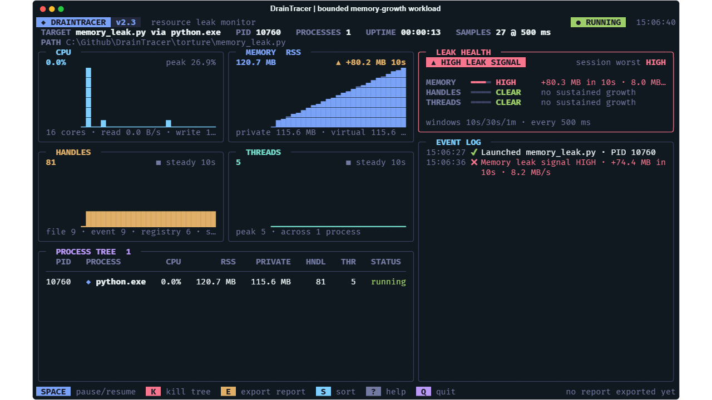

<p align="center">
  
</p>

<p align="center">
  <a href="docs/usage.md"></a>
  <a href="requirements.txt"></a>
  <a href="LICENSE"></a>
</p>

<h1 align="center">DrainTracer</h1>

<p align="center">
  Resource leak monitoring for Windows process trees.<br>
  Launch a program or attach to a PID. Watch what keeps growing.
</p>

<p align="center">
  <a href="#get-started">Get started</a> ·
  <a href="docs/usage.md">Usage</a> ·
  <a href="working-principle.md">How it works</a> ·
  <a href="CONTRIBUTING.md">Contribute</a> ·
  <a href="docs/branding.md">Brand kit</a>
</p>

DrainTracer is a Python CLI/TUI that watches an executable or script and its
recursive child processes. It shows resource usage in a live terminal dashboard
and flags sustained growth in **private memory, handles, and threads**.

Use it to investigate a worker that grows over time, catch resource regressions
in a Windows CI job, or compare the same workload before and after a fix.
The target needs no source changes or instrumentation.

**A leak signal is a lead for investigation, not proof of an unreleased
allocation.** DrainTracer measures process counters; it does not identify
allocation sites. Short runs can be inconclusive.

## See the process behind the growth



*Captured from the real dashboard while monitoring the included bounded
memory-growth workload. Values and process IDs vary by run.*

- **Follow the whole tree.** Observe a target and its discovered descendants,
  including children that outlive their root.
- **Read the trends.** Watch CPU, RSS, private bytes, virtual memory, handles,
  threads, and I/O, with sparklines and per-process measurements.
- **Separate startup from steady state.** Use a warm-up and project profiles
  for cache loading, JIT compilation, or heavier workloads.
- **Investigate handle growth.** See file, socket, registry, event, and other
  handle categories when Windows exposes them.
- **Keep the evidence.** Export JSON and an offline interactive HTML report;
  compare two reports for resolved, new, or worsening signals.
- **Check in CI.** Run headless with a time limit, configurable failure
  severity, GitHub Actions annotations, and a job summary.

## Get started

You need **Windows 10/11**, **Python 3.10+**, and Git to clone the repository.
DrainTracer currently runs from source. From PowerShell:

```powershell
git clone https://github.com/JunaidAhamed-7777/DrainTracer.git
cd DrainTracer
python -m venv .venv
.\.venv\Scripts\python.exe -m pip install -r requirements.txt
.\.venv\Scripts\python.exe src/main.py
```

The last command opens the native file picker. Select an executable, Python
script, or Windows batch file to start monitoring. Calling the virtual
environment's Python directly avoids PowerShell activation-policy changes.

For the examples below, activate that environment or replace `python` with
`.\.venv\Scripts\python.exe`.

### Try an included workload

```powershell
python src/main.py --target .\torture\memory_leak.py --timeout 20s
```

This fixture deliberately grows memory within a fixed bound. Press `E` to
export evidence and `O` to open the HTML report. Try
`.\torture\steady.py` for a stable baseline. The [torture guide](torture/README.md)
explains all fixtures and their limits.

### Monitor your program

```powershell
# Launch a target; quote paths containing spaces
python src/main.py --target "C:\work\My App\worker.exe"

# Pass arguments to the target after --
python src/main.py --target .\worker.py -- --iterations 10

# Attach to a running process; replace 4820 with its actual PID
python src/main.py --pid 4820

# Allow startup growth, then watch a representative workload
python src/main.py --target .\server.exe --warmup 15s --timeout 2m
```

**Process ownership matters:** quitting or timing out stops a launched target
and its tracked tree. An attached target keeps running when you quit.
`Space` pauses the target as well as sampling; `K` terminates it and requires
a second press within three seconds when attached. Protected ancestor trees
disable pause and kill to keep DrainTracer's own terminal usable.

Launched targets have stdin, stdout, and stderr redirected to the null device.
They cannot accept interactive input, and their console logs are not captured.
Use the target's own file logging when needed. See the
[usage guide](docs/usage.md) for attachment, access-denied readings, and cleanup.

## Dashboard keys

- `Space` — pause or resume sampling and the target tree.
- `S` — cycle process order: tree, memory, handles, CPU.
- `E` — export JSON and HTML reports.
- `O` — open the latest HTML export.
- `?` / `H` — show help and active settings; `Esc` closes it.
- `K` — terminate the monitored tree; confirm with a second press when attached.
- `Q` — quit, cleaning up a launched tree or detaching from an attached tree.

The layout adapts to terminal size and uses ASCII fallbacks for legacy Windows
encodings. Startup artwork still comes from [TITLE.txt](TITLE.txt), with a
readable fallback when it cannot be displayed.

## Run a leak check in CI

```powershell
python src/main.py --headless --target .\torture\steady.py --timeout 15s --fail-on medium
```

Headless mode prints progress, exports reports, and exits when the monitored
tree finishes or the time limit passes. Its exit code describes the monitor's
result, rather than forwarding the target's exit code:

- `0` — no observed signal reached the selected threshold. This includes
  `INCONCLUSIVE` runs that never filled a detection window.
- `1` — a signal reached the threshold at any point, even if it later cleared.
- `2` — a usage, startup, monitoring, or report error, unless a higher-priority
  failing signal or interruption applies.
- `130` — interrupted with Ctrl+C before a failing signal.

The default failure threshold is `high`. Allow enough time after warm-up for
a detection window to fill, and inspect the verdict as well as the exit code.
The [headless guide](docs/usage.md#run-without-a-dashboard) covers outcome
priority and GitHub Actions integration.

## Tune it to your workload

Copy [examples/drainrc.toml](examples/drainrc.toml) to `.drainrc` in your project,
or select it explicitly:

```powershell
python src/main.py --config .\examples\drainrc.toml --profile heavy --target .\server.exe
```

Profiles configure sampling, detection windows, warm-up, thresholds, time
limits, and report directories. CLI flags override file settings. The default
sample interval is **500 ms**, with **10 s, 30 s, and 60 s** detection windows.

The detector combines trend slope, monotonic growth, and recovery checks across
eligible windows. A single sample cannot establish a leak signal. Private bytes
drive memory alerts; RSS, CPU, and I/O provide context. Read the
[configuration reference](docs/configuration.md) for discovery, precedence, and
units, and [working-principle.md](working-principle.md) for the detection math.

## Save and compare evidence

Press `E` in the dashboard; headless runs export automatically. Each export
creates `leak_report_<UUID>.json` and `leak_report_<UUID>.html` under
`leak_reports/`, or your chosen `--report-dir`.

The HTML report works offline, with interactive charts, signal episodes, events,
and a process list. JSON supports scripts and report comparisons:

```powershell
python src/main.py diff .\before.json .\after.json
python src/main.py diff .\before.json .\after.json --fail-on-regression
```

Use comparable workloads, durations, warm-ups, and settings. Long sessions use
bounded, thinned history; exported summaries can differ from complete live
history. Reports include local paths and process details, so review them before
sharing. The [report guide](docs/reports.md) covers the schema, retention,
interpretation, and comparison exit codes.

## Documentation

- [Usage and troubleshooting](docs/usage.md) — launch, attach, controls, warm-up,
  headless operation, and diagnostic logging.
- [Configuration](docs/configuration.md) — TOML discovery, profiles, thresholds,
  units, and CLI overrides.
- [Reports and comparisons](docs/reports.md) — export, offline charts, JSON,
  retention, and regression checks.
- [Working principles](working-principle.md) — architecture, metrics, detection
  formulas, process handling, and report fields.
- [Development](docs/development.md) — module map, setup, validation, and
  release preparation.
- [Torture workloads](torture/README.md) — bounded demonstrations and
  real-process verification.
- [Roadmap](future-plan.md) · [Changelog](CHANGELOG.md) ·
  [Brand guide and assets](docs/branding.md).

## Contribute

Bug reports, reproducible workloads, documentation fixes, and focused code
contributions are welcome. Start with [CONTRIBUTING.md](CONTRIBUTING.md);
it covers setup, design boundaries, versioning, and checks.

```powershell
python -m compileall -q src
python -m unittest discover -s tests
python torture\verify_suite.py
```

The real-process suite takes roughly 90 seconds. See
[development](docs/development.md) for focused checks.

[Get help](SUPPORT.md) ·
[Report a bug](https://github.com/JunaidAhamed-7777/DrainTracer/issues/new/choose) ·
[Security policy](SECURITY.md) · [Code of conduct](CODE_OF_CONDUCT.md)

## License

[MIT](LICENSE) · Copyright © 2026 Junaid Ahamed.
