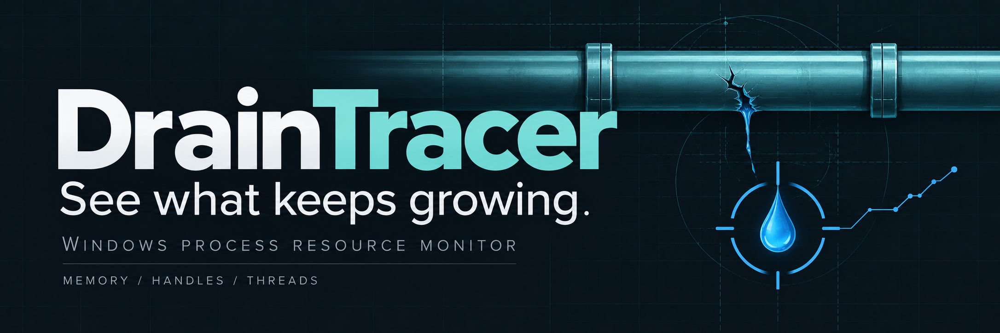
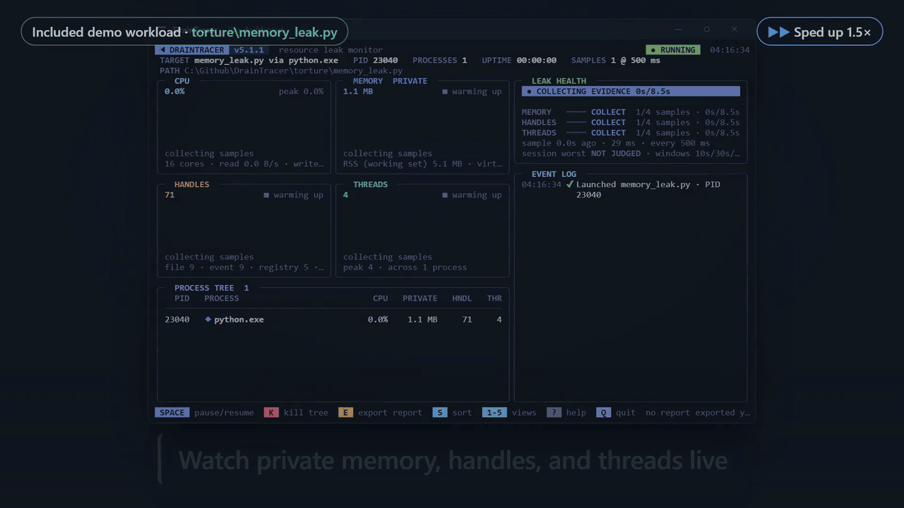
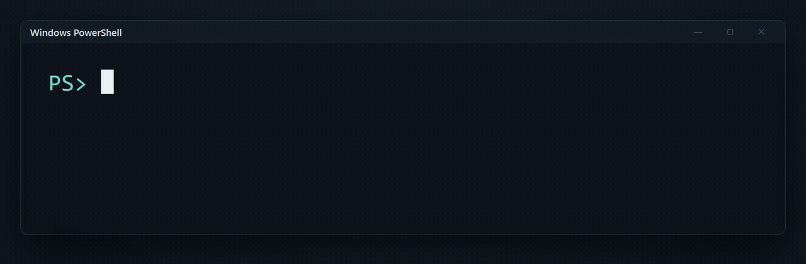
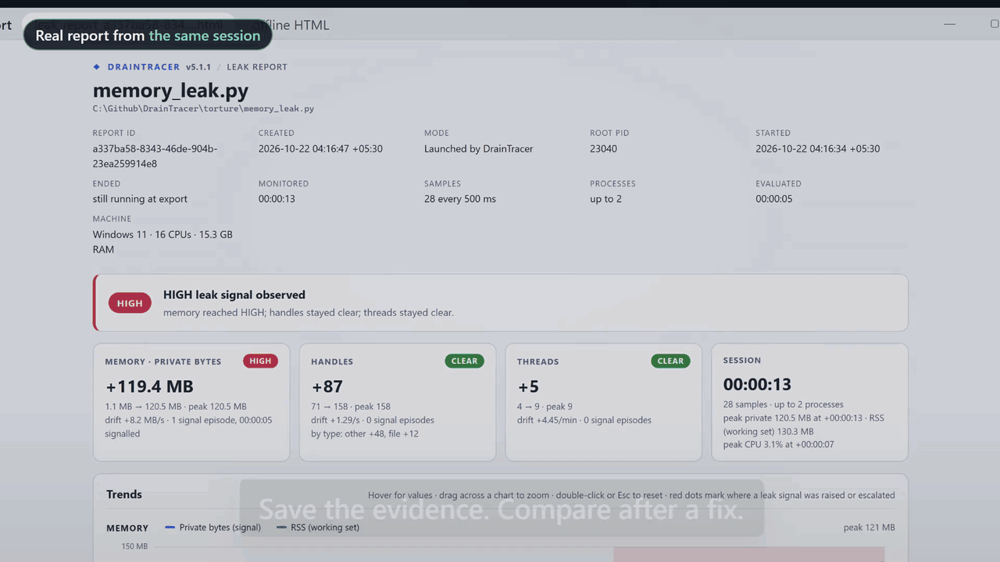

<p align="center">
  
</p>

<p align="center">
  <a href="docs/usage.md"></a>
  <a href="requirements.txt"></a>
  <a href="LICENSE"></a>
</p>

<h1 align="center">DrainTracer</h1>

<p align="center">
  <strong>Release series: v5.4.0</strong> ·
  <a href="RELEASES.md">Current version and release notes</a>
</p>

<p align="center">
  Resource leak monitoring for Windows and Linux process trees.<br>
  Launch a program or attach to a PID. Watch what keeps growing.
</p>

<p align="center">
  <a href="#get-started">Get started</a> ·
  <a href="docs/usage.md">Usage</a> ·
  <a href="working-principle.md">How it works</a> ·
  <a href="CONTRIBUTING.md">Contribute</a> ·
  <a href="docs/branding.md">Brand kit</a> ·
  <a href="LEGAL.md">Privacy and terms</a>
</p>

<p align="center">
  <a href="docs/assets/draintracer-demo.mp4"><strong>▶ Full 30-second demo (MP4)</strong></a><br>
  <sub>GIF excerpts below · recorded with v5.1.1 · silent MP4 · 6.7 MB</sub>
</p>

DrainTracer is a Python CLI/TUI that watches an executable or script and its
recursive child processes. It shows resource usage in a live terminal dashboard
and flags sustained growth in **private memory, handles (file descriptors on
Linux), and threads**. **Linux support has been added in v5.4.0**, including
WSL.

Use it to investigate a worker that grows over time, catch resource regressions
in a Windows or Linux CI job, or compare the same workload before and after a fix.
The target needs no source changes or instrumentation.

**A leak signal is a lead for investigation, not proof of an unreleased
allocation.** DrainTracer measures process counters; it does not identify
allocation sites. Short runs can be inconclusive.

## See the process behind the growth



*A real dashboard session monitoring the included bounded memory-growth
workload, from evidence collection to a HIGH signal. Footage is sped up 1.5×;
values and process IDs vary by run.*

- **Follow the whole tree.** Observe a target and its discovered descendants,
  including children that outlive their root.
- **Read the trends.** Watch CPU, RSS, private bytes, virtual memory, handles,
  threads, and I/O, with sparklines and per-process measurements.
- **Find the growing process.** Alerts name the process whose counter grew
  most over the alert window ("mostly worker.exe PID 1234"), say when growth
  came from newly started workers instead, and the header counts processes
  started and exited. Starts, exits, and restarts appear in the event log.
- **Trust the recording.** Leak health says whether each resource is still
  collecting evidence, judged clean, growing, or unreadable, and how fresh the
  last sample is ("sample 0.4s ago · 12 ms · cadence 502 ms"), amber when
  samples go stale; reports add coverage and the monitor's own CPU and memory.
- **Ask why.** Focused views rank growing processes, show each detection
  window's checks behind a verdict, annotate a timeline with your markers, and
  report monitor health, without pausing sampling.
- **Separate startup from steady state.** Use a warm-up and project profiles
  for cache loading, JIT compilation, or heavier workloads.
- **Investigate handle growth.** See file, socket, registry, event, and other
  handle categories when Windows exposes them; Linux classifies file,
  socket, eventfd, and other descriptors through `/proc`.
- **Keep the evidence.** Export JSON and an offline interactive HTML report;
  compare two labeled runs for resolved, new, or worsening signals, with
  verdicts qualified (or refused under `--strict`) when the runs differ.
- **Check in CI.** Run headless with a time limit, configurable failure
  severity, optional policies and absolute budgets, GitHub Actions
  annotations, and a job summary.

## Get started

You need **Windows 10/11 or Linux** and **Python 3.10+**. Windows examples
use PowerShell; Linux examples use a shell such as Bash.

### Install from PyPI

```powershell
python -m pip install draintracer
draintracer --help
draintracer
```

DrainTracer is available on [PyPI](https://pypi.org/project/draintracer/).
You can also install the current `main` branch from GitHub without needing Git:

```powershell
python -m pip install https://github.com/JunaidAhamed-7777/DrainTracer/archive/refs/heads/main.zip
```

You can also install a built wheel or source archive with
`python -m pip install PATH_TO_FILE`.

If the command is not on `PATH`, use `python -m draintracer --help` or
`python -m draintracer` with the same Python used to install it. Run from
your project folder: configuration discovery starts there, and reports
are written relative to that working directory by default.

### Install from a checkout

Clone the repository to use the included workloads or develop DrainTracer.
This route needs Git:

```powershell
git clone https://github.com/JunaidAhamed-7777/DrainTracer.git
cd DrainTracer
python -m venv .venv
.\.venv\Scripts\python.exe -m pip install .
.\.venv\Scripts\python.exe -m draintracer
```

The existing source command also works: install `requirements.txt` with
the same Python, then run `python src/main.py` from the checkout. For the
source examples below, activate the environment or replace `python` with
`.\.venv\Scripts\python.exe`. Calling that executable directly avoids
PowerShell activation-policy changes.

### Linux, including WSL

From a checkout, create a Linux Python environment and install DrainTracer:

```bash
python3 -m venv .venv
.venv/bin/python -m pip install .
.venv/bin/python -m draintracer --help
.venv/bin/python -m draintracer --target ./torture/memory_leak.py --timeout 20s
```

On Ubuntu/Debian, install `python3-venv` if `python3 -m venv` reports that
it is missing. Run these commands inside WSL to monitor Linux processes.
Use the Windows installation to monitor Windows processes.

Linux supports native executables, executable scripts with a valid `#!`
interpreter line, and `.py` files through DrainTracer's Python. For example:

```bash
.venv/bin/draintracer --target /usr/bin/sleep -- 30
.venv/bin/draintracer --pid 4820
.venv/bin/draintracer --headless --target ./torture/steady.py --timeout 15s
```

The startup menu, process browser, dashboard keys, pause/resume, JSON/HTML
exports, and headless checks work on Linux. A desktop file dialog uses
optional tkinter; without Tk or a display, startup asks for a typed path.
`--target` and `--pid` work without a desktop. Windows `.exe`, `.bat`, and
`.cmd` programs require Windows.

On Linux, **private bytes measure USS (private resident memory)** and
**handles count open file descriptors**, including files, sockets, and
pipes. `--budget-handles` therefore checks the peak descriptor count and
fails a headless run when it exceeds the budget. Protected
`/proc` measurements appear as unavailable. Reports record these definitions;
strict comparisons reject differing platforms or counter definitions.
Compare memory and resource trends between runs on the same platform.

Linux launches use an isolated session to retain descendants after a parent
exits. A child that creates another session before discovery can escape
tracking. Attachment tracks discovered descendants and leaves the target
running when you quit. See [Usage](docs/usage.md) for permissions and cleanup.

Before starting from a checkout, DrainTracer checks the committed
[runtime snapshot](runtime-manifest.json) for required source files, title
artwork, and report frames. If files are missing, it lists them and offers
**Enter** to run `git pull --ff-only origin main`, restore missing tracked
files, and restart with the same Python and arguments. **Q** cancels.
The check runs on every launch, including the first. Generated reports and
user settings are not required. Headless or redirected runs report missing
files with exit code `2` without prompting or pulling. Installed packages
check their bundled runtime files and assets instead; an incomplete
installation gives pip reinstall guidance and never attempts Git recovery.

Interactive startup checks PyPI for a newer stable release, waiting at most one
second. Below the version subtitle it shows **New Version Available!** in red
with `pip install --upgrade draintracer` in green, or **No new updates.** with a
blue contribution link. Offline or failed checks show **Update check
unavailable.** instead. Headless runs, help, version-only commands, and
redirected output do not contact PyPI.

The check sends the DrainTracer version in its user-agent, and PyPI sees the
connecting IP address. Process reports are not uploaded. Read the
[privacy policy](PRIVACY.md) for the request details, modes that skip it, and
local data handling.

Once the installation check passes, `draintracer` offers two startup choices:

- **Open a program:** select an executable or script in the desktop file
  picker, or enter its path on Linux without a desktop.
- **Hook to a running program:** browse up to 15 names and PIDs at a
  time. Use **Up/Down** to highlight a program and **Enter** to select it,
  or type a listed PID and press Enter. The list filters as you type a
  name or PID; Backspace updates it immediately. Use `/next` and `/prev`
  for pages, `/refresh` to reload, and
  `/clear` to reset the search. Quitting detaches and leaves the program running.

Use **Up/Down** to highlight a startup choice, then **Spacebar** (or Enter)
to select it. Navigation help appears below the Get Started box. Redirected
or non-terminal input keeps the numbered `1`/`2` prompt.

Press `Q` to cancel either startup prompt, or Escape in the keyboard menu.
Supplying `--target` or `--pid`
skips the menu. All installed-command examples also work with
`python -m draintracer`; checkout users can use `python src/main.py`.

### Try an included workload

These fixtures are in the source checkout; run from its root:

```powershell
python src/main.py --target .\torture\memory_leak.py --timeout 20s
```

This fixture deliberately grows memory within a fixed bound. Press `E` to
export evidence and `O` to open the HTML report. Try
`.\torture\steady.py` for a stable baseline. The [torture guide](torture/README.md)
explains all fixtures and their limits.



*Install-and-launch commands from the demo. The `torture` workload shown here
requires a source checkout; it is not included in the PyPI package.*

### Monitor your program

```powershell
# Launch a target; quote paths containing spaces
draintracer --target "C:\work\My App\worker.exe"

# Pass arguments to the target after --
draintracer --target .\worker.py -- --iterations 10

# Attach to a running process; replace 4820 with its actual PID
draintracer --pid 4820

# Allow startup growth, then watch a representative workload
draintracer --target .\server.exe --warmup 15s --timeout 2m
```

Python script targets run with DrainTracer's Python interpreter. Install
DrainTracer in the target's environment, or explicitly launch that
environment's Python and pass the script after `--`:

```powershell
draintracer --target "C:\work\app\.venv\Scripts\python.exe" -- "C:\work\app\worker.py"
```

**Process ownership matters:** quitting or timing out stops a launched target
and its tracked tree. An attached target keeps running when you quit.
`Space` pauses the target as well as sampling; `K` terminates it and requires
a second press within three seconds when attached. Protected ancestor trees
disable pause and kill to keep DrainTracer's own terminal usable.
Forced stops allow up to three seconds for cleanup before reporting any
processes that could not be stopped.

Launched targets have stdin, stdout, and stderr redirected to the null device.
They cannot accept interactive input, and their console logs are not captured.
Use the target's own file logging when needed. See the
[usage guide](docs/usage.md) for attachment, access-denied readings, and cleanup.

## Dashboard keys

- `Space` — pause or resume sampling and the target tree.
- `S` — cycle process order: tree, memory (private bytes), handles, CPU.
- `E` — export JSON and HTML reports.
- `O` — open the latest HTML export.
- `M` — add a numbered marker (`marker N`) to the event log, timeline, and report.
- `?` / `H` — show help and active settings; arrows scroll it, `Esc` closes it.
  While help is open, only scrolling, closing help, and view selection are active.
  Close it before using target controls, exporting, or quitting.
- `K` — terminate the monitored tree (never only a selected process); confirm
  with a second press when attached.
- `Q` — quit, cleaning up a launched tree or detaching from an attached tree.

Number keys open focused views; `Esc` returns to the overview. Views change
only what is shown: sampling and the target continue unaffected.

| Key | View | Its own keys |
| --- | --- | --- |
| `1` | Overview: cards, process tree, leak health, events | `S` sort |
| `2` | Processes: tree or growth ranking, exited processes, selected-process detail | `↑`/`↓` select, `/` search, `S` order, `←`/`→` interval, `Tab` focus, `Enter` detail |
| `3` | Evidence: each window's points, slope, monotonic and drop ratios, score, and verdict | `←`/`→` resource, `↑`/`↓` scroll |
| `4` | Timeline: one chart with process, pause, signal, and marker annotations | `←`/`→` chart, `F` freeze view, `↑`/`↓` annotations |
| `5` | Monitor: cadence, collection cost, coverage, freshness, monitor footprint | — |

`F` freezes only the timeline view; `Space` still pauses the target.
Markers record timing, not cause, and severity is a heuristic tier, not a
probability. At 80x24 a view keeps one status line; taller terminals add the
header and event log.

Leak health shows the current evidence apart from the session's worst signal:
`COLLECTING EVIDENCE` until the shortest window fills, `NO SUSTAINED GROWTH`
once one was judged clean, a severity when growth is detected, and
`UNAVAILABLE` or `PARTIAL` when processes cannot be read. Unreadable counters
count as unknown, never zero, and access changes restart detection windows.

The layout adapts to terminal size and uses ASCII fallbacks for legacy Windows
encodings. Startup artwork still comes from [TITLE.txt](TITLE.txt), with a
readable fallback when it cannot be displayed.

## Run a leak check in CI

From the source checkout, use the included stable workload:

```powershell
python src/main.py --headless --target .\torture\steady.py --timeout 15s --fail-on medium
```

Headless mode prints progress, exports reports, and exits when the monitored
tree finishes or the time limit passes. Its exit code describes the monitor's
result, rather than forwarding the target's exit code:

- `0` — no observed signal reached the selected threshold. This includes
  `INCONCLUSIVE` runs that never filled a detection window.
- `1` — a signal reached the threshold at any point, even if it later cleared.
- `2` — a usage, startup, monitoring, or report error, unless a higher-priority
  failing signal or interruption applies.
- `3` / `4` — only with `--fail-on-inconclusive` (no window judged) or
  `--fail-on-target-error` (the launched target exited non-zero).
- `5` — only with a budget such as `--budget-private 500MB`,
  `--budget-handles 2000`, or `--budget-threads 64`: a peak exceeded it,
  even with no leak signal, because stable usage can still be excessive.
- `130` — interrupted with Ctrl+C before a failing signal.

Handle and thread budgets must be positive whole numbers, both in flags
and settings files. Fractional private-byte sizes such as `1.5MB` and
fractional growth-rate thresholds remain supported.

The summary and report keep the target outcome, the measurement outcome
(conclusive, partial coverage, or inconclusive), and monitor errors apart.
The default failure threshold is `high`. Allow enough time after warm-up for
a detection window to fill, and inspect the verdict as well as the exit code.
The [headless guide](docs/usage.md#run-without-a-dashboard) covers outcome
priority and GitHub Actions integration.

## Tune it to your workload

Copy [examples/drainrc.toml](examples/drainrc.toml) to `.drainrc` in your project.
From a source checkout, you can also select that example explicitly:

```powershell
draintracer --config .\examples\drainrc.toml --profile heavy --target .\server.exe
```

Profiles configure sampling, detection windows, warm-up, thresholds, time
limits, and report directories. CLI flags override file settings. The default
sample interval is **500 ms**, with **10 s, 30 s, and 60 s** detection windows.

The detector combines trend slope, monotonic growth, and recovery checks across
eligible windows. A single sample cannot establish a leak signal. Private bytes
drive memory alerts, so the memory card, compact strip, and narrow process
tables show `PRIVATE`; RSS (working set), CPU, and I/O provide context, and
neither memory counter alone proves an allocation leak. Read the
[configuration reference](docs/configuration.md) for discovery, precedence, and
units, and [working-principle.md](working-principle.md) for the detection math.

## Save and compare evidence

Press `E` in the dashboard; headless runs export automatically. Each export
creates a JSON/HTML pair under
`leak_reports/reports/worker.exe_2026-10-21/` for a program named `worker.exe`
on that date. The actual program filename and recorded creation date name
the folder; UUID filenames keep repeated exports distinct. `--report-dir`
changes the output root while keeping that grouping. The default output root
is relative to your working directory, including for installed packages.
Reusable HTML styles and chart code live in the committed
`leak_reports/frames/` directory and are bundled in installed packages;
generated reports are ignored by Git.

The HTML report works offline, with interactive charts, signal episodes,
events, a process list, a ranking of growing processes that keeps ones that
exited, run provenance, and monitor diagnostics.



*The offline HTML report from the same demo session: inspect the summary,
resource trends, events, and process growth after recording.*

Use the JSON reports for scripts and comparisons:

```powershell
draintracer diff .\before.json .\after.json
draintracer diff .\before.json .\after.json --fail-on-regression
draintracer diff .\before.json .\after.json --strict --budget-private 500MB
```

Label each run so comparisons can tell equivalent experiments apart:
`--workload-id`, `--build`, `--operations N` (shows growth per operation),
and `--note` are recorded in the report's `experiment` section with the
sampling settings and machine details. Target arguments are only counted and
fingerprinted; one-sided argument records qualify comparisons, including
known zero arguments versus unknown arguments. Environment variables are never recorded, and
`password=...`-style values and Basic/Bearer credentials in labels are redacted.
Short valid Basic credentials are covered too; review reports before sharing.
Any comparability caveat
qualifies the verdict, for example `IMPROVED (QUALIFIED)`, so a shorter or
lighter run cannot earn a clean result. `--strict` instead reports
`NOT COMPARABLE` (different targets, workloads, arguments, settings, operation
counts, or lengths over 2x apart) or `INSUFFICIENT COVERAGE` (an unjudged run
or partial coverage) and exits `3`; a diff budget exceeded by the later run
exits `4`. Coverage caveats use recorded whole-session counts when available,
including wholly unreadable samples, even after chart history is thinned.

Use comparable workloads, durations, warm-ups, and settings. Long sessions
thin the stored chart history; reports then say "chart thinned 1:N", while
peaks with their times, worst severities, signal episode counts, evaluated
time, and sample counts stay exact in `session_facts`. Reports include local
paths and process details, so review them before sharing. The
[report guide](docs/reports.md) covers the schema, retention, interpretation,
and comparison exit codes.

## Documentation

- [Usage and troubleshooting](docs/usage.md) — launch, attach, controls, warm-up,
  headless operation, and diagnostic logging.
- [Configuration](docs/configuration.md) — TOML discovery, profiles, thresholds,
  units, and CLI overrides.
- [Reports and comparisons](docs/reports.md) — export, offline charts, JSON,
  retention, and regression checks.
- [Working principles](working-principle.md) — architecture, metrics, detection
  formulas, process handling, and report fields.
- [Development](docs/development.md) — module map, setup, validation, and
  release preparation.
- [Torture workloads](torture/README.md) — bounded demonstrations and
  real-process verification.
- [Roadmap](future-plan.md) · [Changelog](CHANGELOG.md) ·
  [Brand guide and assets](docs/branding.md).

## Contribute

Bug reports, reproducible workloads, documentation fixes, and focused code
contributions are welcome. Start with [CONTRIBUTING.md](CONTRIBUTING.md);
it covers setup, design boundaries, versioning, and checks.

```powershell
python -m compileall -q src
python -m unittest discover -s tests
python torture\verify_suite.py
```

The real-process suite takes roughly 90 seconds. See
[development](docs/development.md) for focused checks.

[Get help](SUPPORT.md) ·
[Report a bug](https://github.com/JunaidAhamed-7777/DrainTracer/issues/new/choose) ·
[Security policy](SECURITY.md) · [Code of conduct](CODE_OF_CONDUCT.md)

## Privacy and terms

Monitoring and report generation run locally. Interactive startup makes the
PyPI update request described above; the application has no automatic report
upload, account system, or usage analytics. Reports and optional diagnostic
logs can contain identifying paths, process details, and free text. They have
no built-in expiry or encryption, and label redaction does not sanitize the
whole report. Review both JSON and embedded HTML data before sharing.

- [Privacy policy](PRIVACY.md) — local data, network requests, voluntary
  submissions, retention, and privacy requests.
- [Terms of use](TERMS.md) — authorized monitoring, process-control risks,
  contributions, support limits, and the MIT license's priority.
- [Privacy and safe sharing](docs/privacy.md) — practical report review,
  storage, logging, CI visibility, and deletion.
- [Legal and policy index](LEGAL.md) — all policies and private contact routes.
- [Third-party notices](THIRD_PARTY_NOTICES.md) — dependency licenses and
  redistribution responsibilities.

## License

[MIT](LICENSE) · Copyright © 2026 Junaid Ahamed.
