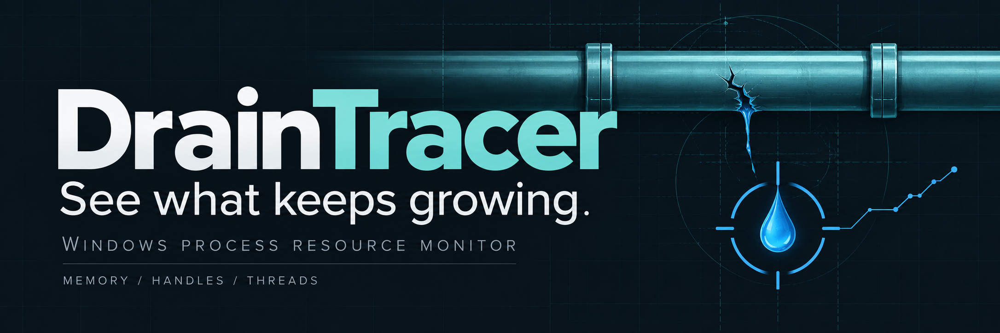
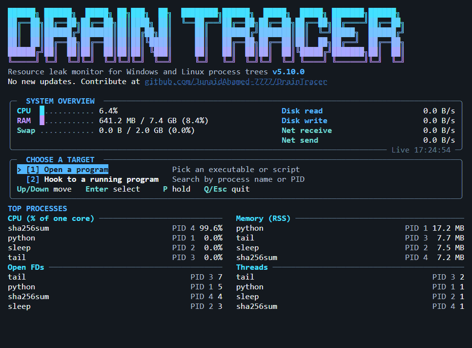
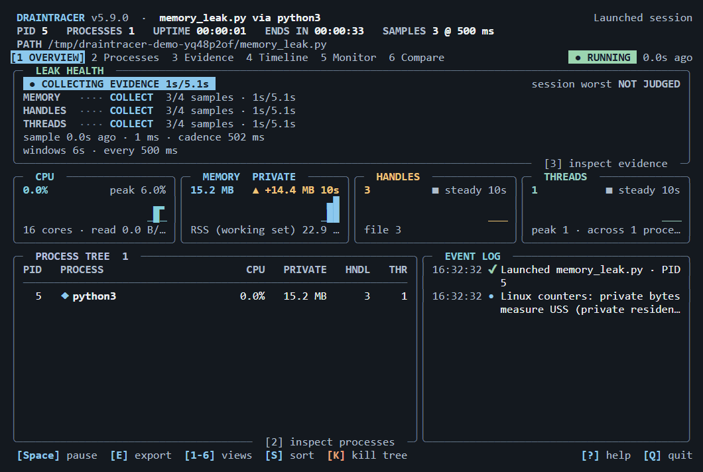
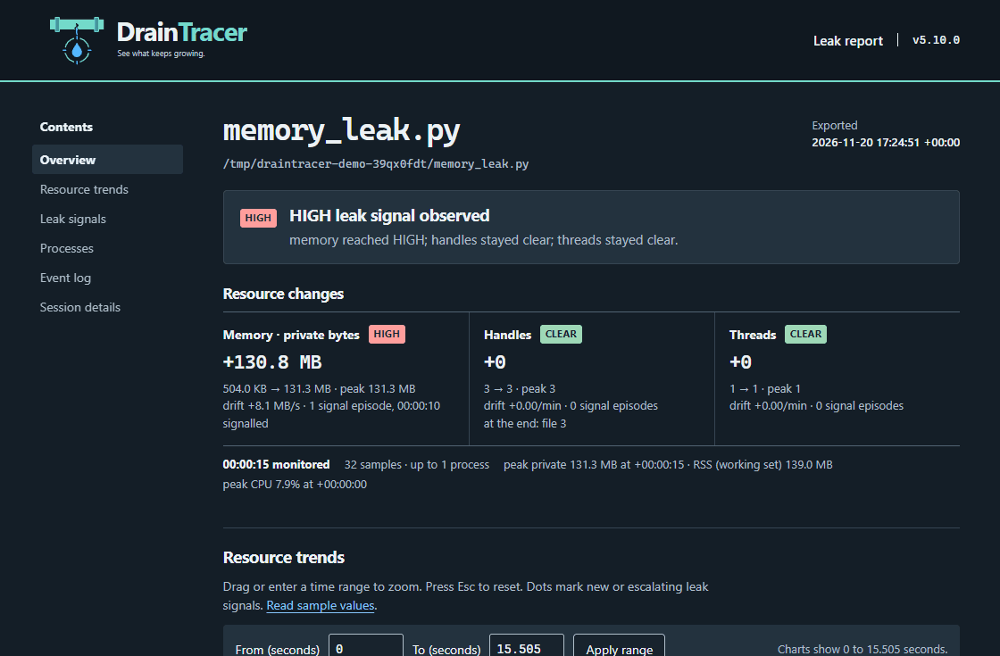

# DrainTracer



Resource growth monitoring for **Windows 10/11 and Linux** with **Python 3.10+**.
Launch an executable or script, or attach to a PID, and watch its recursive
process tree in a live terminal dashboard. The target needs no source
changes or instrumentation.

DrainTracer flags sustained growth in private memory, handles or Linux file
descriptors, and threads.
A signal is a lead for investigation, not proof of an unreleased allocation.
Process counters do not identify allocation sites, and short runs can be
inconclusive.

## Install and run

From PowerShell:

```powershell
python -m pip install draintracer
draintracer --version
draintracer
```

If the command is not on `PATH`, use `python -m draintracer` with the same
Python used for installation. In an interactive terminal, the startup overview
shows live CPU, RAM, swap, disk read/write rates and network traffic.
It ranks processes by CPU, memory, handles
(open file descriptors on Linux), and threads. Press **P** to hold or
resume the display, **1** to open a program, or **2** to hook to a running
process. Cancel either picker to return to the overview.



On Linux, install into a virtual environment:

```bash
python3 -m venv ~/.venvs/draintracer
~/.venvs/draintracer/bin/python -m pip install draintracer
~/.venvs/draintracer/bin/python -m draintracer --version
~/.venvs/draintracer/bin/draintracer --target /usr/bin/sleep -- 30
```

Linux supports native executables, Python `.py` targets, and executable
scripts with a shebang. Batch files and Windows executables require Windows.
A desktop picker uses optional tkinter; without a display or tkinter, enter
the target path in the terminal or pass `--target`. The dashboard and
headless mode work in Linux terminals and WSL.

```powershell
# Launch a program
draintracer --target "C:\work\My App\worker.exe"

# Attach to an existing process; substitute its actual PID
draintracer --pid 4820

# Allow startup growth before checking a representative workload
draintracer --target .\server.exe --warmup 15s --timeout 2m
```

Quitting stops a launched target and its tracked tree. Quitting an attached
session leaves the target running. Launched targets have their console
input and output redirected; use their own file logging when needed.

Launched Linux trees receive their own session so descendants can be
rediscovered after a parent exits. A daemon that leaves that session before
being discovered can escape tracking; attach to its actual PID to monitor
it. Attachment leaves session ownership alone and never includes unrelated
processes merely because they share a session.

Python script targets use DrainTracer's Python interpreter. Install
DrainTracer in the target's environment, or launch that environment's
Python explicitly and put the script after `--`:

```powershell
draintracer --target "C:\work\app\.venv\Scripts\python.exe" -- "C:\work\app\worker.py"
```

## Inspect and save evidence



This Linux recording uses `torture/memory_leak.py`, a bounded example
included in the [source checkout](https://github.com/JunaidAhamed-7777/DrainTracer#try-an-included-workload).

Track CPU, memory, handles, threads, and I/O across the discovered process
tree. Use warm-up settings and project profiles to account for startup or
legitimate workload growth.

Leak health says whether evidence is still being collected, whether a
window showed no sustained growth, and whether any process could not be
measured. Memory alerts are based on private bytes, shown alongside RSS
(working set). Alerts name the processes that grew. Number keys open a
process inspector, the evidence behind each signal, an annotated
timeline, and monitor diagnostics. On page **6**, press **P** to compare
two running PIDs or **B** to compare this session with a saved DrainTracer
JSON report. **Esc** returns to page **1**. From there **Q** or **Esc** quits.

On Linux, private memory is USS (unique resident pages); Windows uses private
committed bytes. Linux `handles` readings and `--budget-handles` count open
file descriptors. The report keeps the existing `private_bytes` and
`handles` keys and records their platform semantics in its environment
metadata. Linux descriptor categories include files, sockets, eventfds, and
other descriptors such as pipes. `/proc` permissions can hide individual
counters; unavailable data stays unknown, and RSS is never substituted for
private memory. Compare runs using the same platform and workload.

Press **E** to export JSON and an offline interactive HTML report. Press **O**
to open the HTML. **Last Report** in the overview footer and the folder path
in the session summary both open the export directory in a compatible terminal.



Use the report contents to jump to **Resource trends** or **Leak signals**.
The retained-sample table beneath the charts can also be read with a keyboard.

Headless mode supports bounded checks, severity-based exit codes, and
GitHub Actions annotations and summaries. Compare saved evidence with
`draintracer diff before.json after.json`; add `--strict` to refuse
verdicts for runs that are not comparable, and record `--workload-id`,
`--build`, and `--operations` to make comparisons defensible. Reports
default to `leak_reports/reports` under the working directory. Review local
paths and process details before sharing exports.

## Privacy and terms

Monitoring and reports stay local unless you or your environment share them.
Interactive startup automatically checks PyPI for updates, sending the
DrainTracer version in its user-agent and exposing the connecting IP address
to PyPI. The check does not upload process data or install an update.
Headless runs, help, version-only commands, report comparisons, and redirected
startup output skip it. There is no dedicated interactive opt-out flag.

Reports and optional diagnostic logs can contain sensitive paths and process
details. They have no built-in expiry or encryption; existing label redaction
does not sanitize the entire JSON or HTML report. Read the
[privacy policy](https://github.com/JunaidAhamed-7777/DrainTracer/blob/main/PRIVACY.md),
[terms of use](https://github.com/JunaidAhamed-7777/DrainTracer/blob/main/TERMS.md),
and [safe sharing guide](https://github.com/JunaidAhamed-7777/DrainTracer/blob/main/docs/privacy.md).
The terms preserve the MIT software license. The project operates no hosted
monitoring or report-storage service.

## Documentation and contributions

- [Usage and troubleshooting](https://github.com/JunaidAhamed-7777/DrainTracer/blob/main/docs/usage.md)
- [Configuration](https://github.com/JunaidAhamed-7777/DrainTracer/blob/main/docs/configuration.md)
- [Reports and comparisons](https://github.com/JunaidAhamed-7777/DrainTracer/blob/main/docs/reports.md)
- [Detection and process handling](https://github.com/JunaidAhamed-7777/DrainTracer/blob/main/working-principle.md)
- [Release notes](https://github.com/JunaidAhamed-7777/DrainTracer/blob/main/RELEASES.md)
- [Source and contributions](https://github.com/JunaidAhamed-7777/DrainTracer)
- [Report a bug](https://github.com/JunaidAhamed-7777/DrainTracer/issues/new/choose)
- [Legal and policy index](https://github.com/JunaidAhamed-7777/DrainTracer/blob/main/LEGAL.md)
- [Third-party notices](https://github.com/JunaidAhamed-7777/DrainTracer/blob/main/THIRD_PARTY_NOTICES.md)

Released under the [MIT license](https://github.com/JunaidAhamed-7777/DrainTracer/blob/main/LICENSE).
